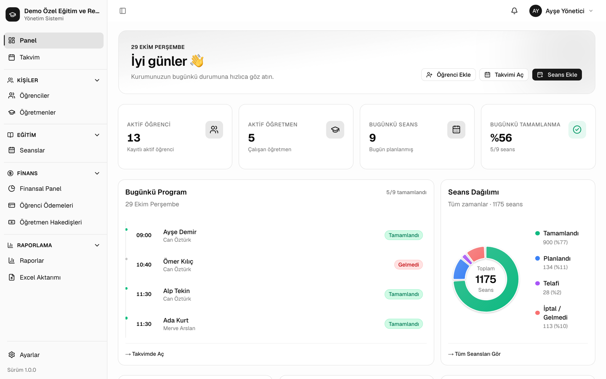
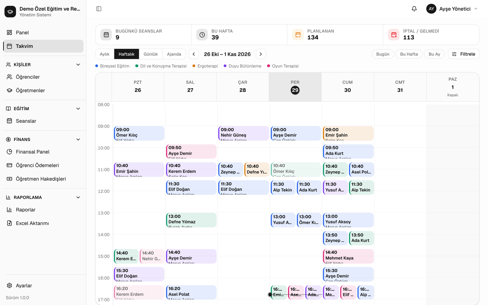
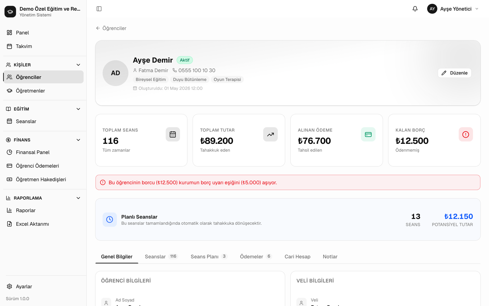
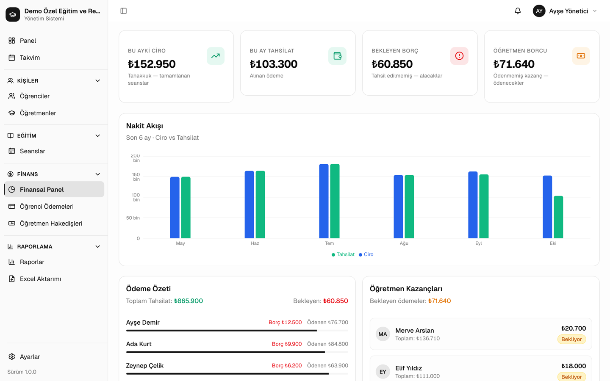
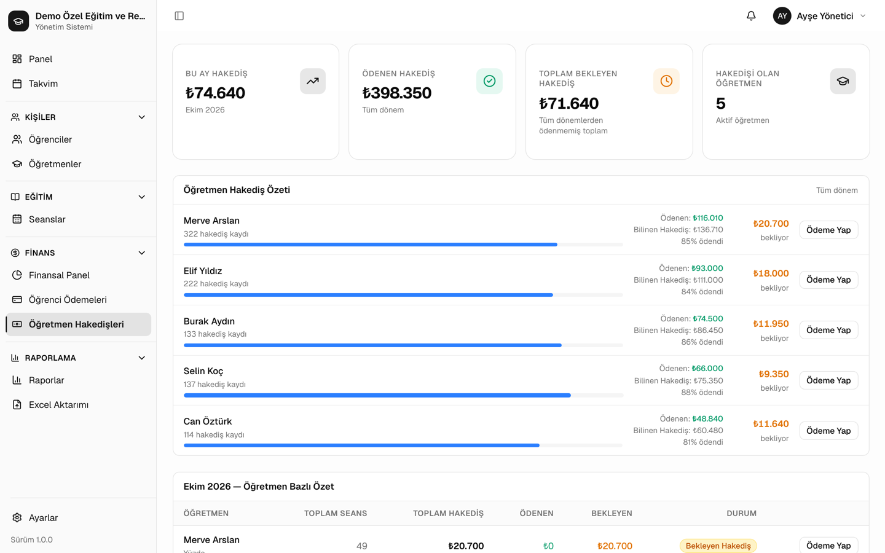
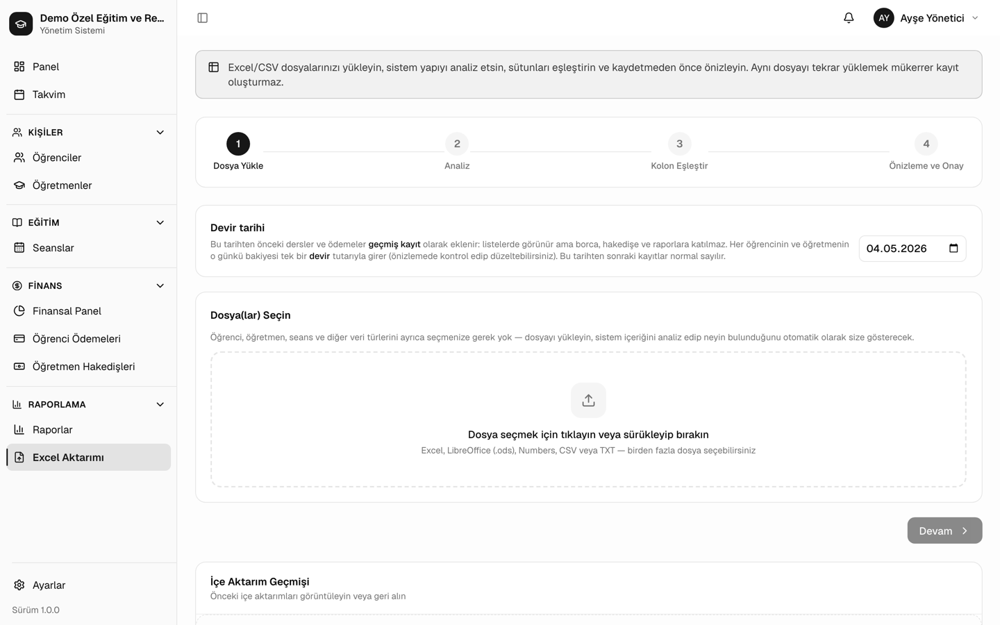

# Special Education Management System

[Türkçe](README.tr.md)

A web application that replaces the Excel workbooks a special education center used to run its day-to-day work: students, teachers, lesson scheduling, parent payments, teacher earnings and reports. It is **in production use at a special education center in Turkey**, where several staff members work in it at the same time from different devices.

The interface is in Turkish; the code, comments and this document are in English.



<table>
  <tr>
    <td><br><sub>Weekly calendar, colored by therapy type</sub></td>
    <td><br><sub>Student account: lessons, payments, debt warning</sub></td>
  </tr>
  <tr>
    <td><br><sub>Finance: billed vs. collected, receivables</sub></td>
    <td><br><sub>Teacher earnings and payments</sub></td>
  </tr>
  <tr>
    <td colspan="2"><br><sub>Excel import: analyze, map columns, preview, roll back</sub></td>
  </tr>
</table>

<sub>All names and figures in the screenshots are fictional demo data.</sub>

## Features

- **Students**: enrollment, lesson history and a running account per student (charges, payments, opening balance carried over from Excel).
- **Teachers**: four pay models (per lesson, fixed salary, salary plus a lesson quota, percentage of revenue), per-subject rates, payments and advances, and merging duplicate teacher records with undo.
- **Scheduling**: weekly recurring plans, a calendar, 40-minute and double lessons with configurable breaks, and conflict detection for both teachers and students.
- **Finance**: parent payments with sequential receipt numbers, receivables, and amounts owed to each teacher by month.
- **Reports**: finance, lesson, teacher and student reports with CSV export and print layouts.
- **Excel import**: imports an arbitrary workbook by mapping its columns, matches names to existing records, previews every change, and can roll back a whole import.
- **Backups**: download and restore a full backup file, plus an automatic daily backup to a local folder (File System Access API).
- **Staff account**: an optional second login that sees lessons, the calendar, students and teachers, but never money. The server enforces this, not just the UI.

## Architecture

```text
Browser (Next.js App Router, React 19)
  │  useStore(): all records + actions, business rules run client-side
  │  gzip JSON, optimistic version, 8 s change polling
  ▼
Next.js route handlers on Vercel (/api/auth, /api/state, /api/staff, /api/setup)
  │  session cookie check, same-origin check, staff view filtering
  ▼
Neon Postgres (jsonb document + version, accounts, sessions)
```

- **Concurrent editing.** Each save sends the version it was based on. If another device saved first, the server answers `409` with the latest data, and the client merges its own changes record by record and field by field ([merge.ts](src/lib/data/merge.ts)), then retries. Sequential numbers that collide, such as receipt and student numbers, are renumbered on merge.
- **Batched, resilient saves.** Changes are debounced and sent together. Failed saves retry with a visible warning, and the browser warns before closing a tab with unsaved changes.
- **Business rules are pure functions** in [src/lib/helpers](src/lib/helpers): billing, teacher earnings, salary periods, advances carried across months, makeup lessons, conflict detection and Excel parsing. Most of them are unit tested.
- **Role separation on the server.** [staff-view.ts](src/lib/server/staff-view.ts) strips payments, earnings, prices and salaries from what the staff account receives. It also accepts only the parts of a staff save that staff are allowed to change, and recalculates lesson prices on the server.

More detail, including the data model and the invariants a future backend must keep, is in [docs/BACKEND.md](docs/BACKEND.md) (Turkish).

## Security

- Passwords are hashed with **scrypt**. Sessions are random tokens in `httpOnly` cookies, and only their SHA-256 hash is stored.
- Brute-force protection is applied per IP and globally. Changing a password signs out the account's other devices.
- Requests that change data must come from the app's own pages (same-origin check).
- A strict Content Security Policy, HSTS and frame blocking are set in [next.config.ts](next.config.ts). API responses are never cached.
- The app was scanned with OWASP ZAP and the findings were fixed.
- No default account exists. The first visitor completes a setup screen.

## Tech stack

Next.js 16 (App Router), React 19, TypeScript, Tailwind CSS 4, shadcn/ui (Base UI), Recharts, SheetJS, Neon Postgres, Vitest. Deployed on Vercel.

## Running locally

Requires Node.js 20+ and a Postgres database reachable through `@neondatabase/serverless` (a free Neon project works). Tables are created on the first request.

```bash
npm install
echo 'DATABASE_URL=postgres://…' > .env.local   # use a separate database, not production
npm run dev                                      # http://localhost:3000
```

| Command | Purpose |
|---|---|
| `npm run dev` | Development server |
| `npm run build` | Production build |
| `npm test` | Unit tests (Vitest) |
| `npm run typecheck` | TypeScript check |
| `npm run lint` | ESLint |

## Project structure

```text
src/
 ├── app/          # Pages: (auth)/login and setup, (app)/app/*, api/* route handlers
 ├── components/   # Page components and ui/ primitives
 ├── hooks/        # Shared React hooks
 ├── lib/
 │   ├── auth/     # Client auth, password policy, staff screen access
 │   ├── backup/   # Folder backups
 │   ├── data/     # Store, server sync, merge, backup format
 │   ├── helpers/  # Business rules: billing, earnings, conflicts, Excel import
 │   ├── server/   # Auth core, repositories, staff view, cookies, gzip
 │   └── settings/ # Institution settings, defaults, validation
 └── types/        # Shared types
```

## License

Copyright © 2026 Ömer Pehriz. All rights reserved. The source is published for viewing; it may not be copied, modified or redistributed without permission.
